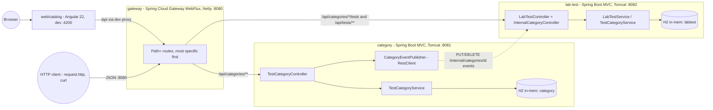
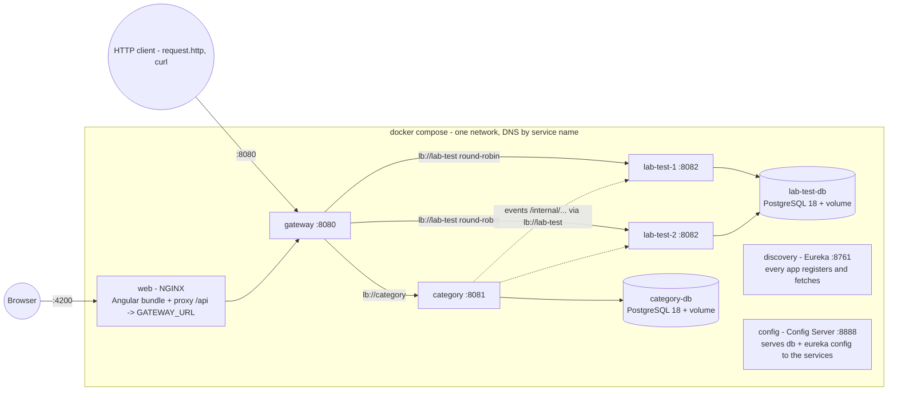
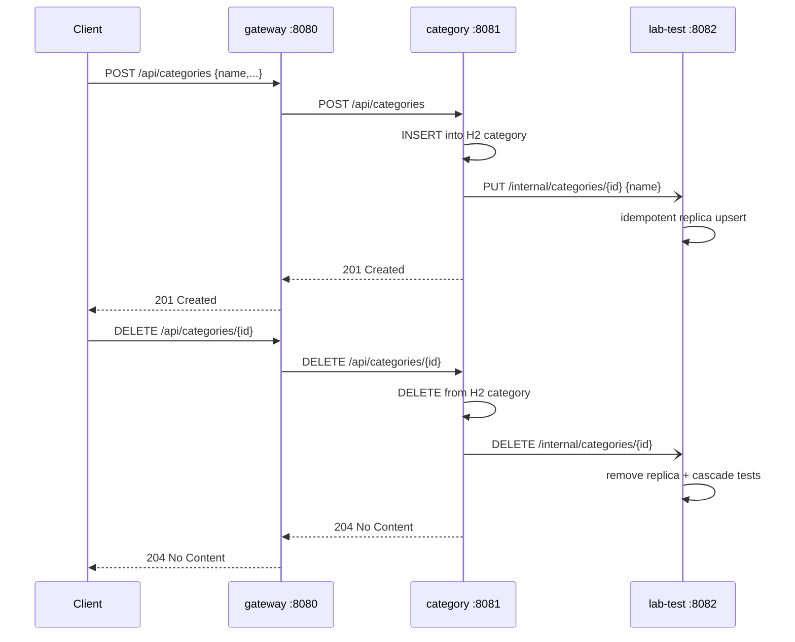
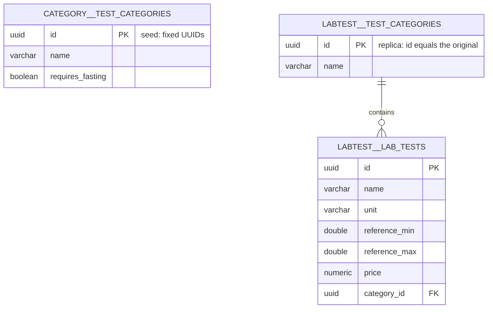

# Medata — architecture

> English version. Polish 1:1 counterpart: [../pl/ARCHITECTURE.md](../pl/ARCHITECTURE.md)
> As of: lab 7 (discovery, load balancing, migrations, central config). Convention §6: an architecture change without a diagram update = an unfinished change.

## Container view (development mode)

Each service owns a **private** database — there is no shared schema and no foreign key across services. Consistency is kept by REST events and the fixed seed UUIDs. In development mode the database is in-memory H2; under Docker Compose the very same jar talks to PostgreSQL, switched by the config service and environment variables (see below). Since lab 7 development mode also needs the discovery service on :8761, because the gateway resolves its `lb://` targets from the registry.

## Runtime view (Docker Compose — lab 7)

Host ports are published for `web` (:4200), `gateway` (:8080) and the two infrastructure dashboards, `discovery` (:8761) and `config` (:8888). The business services and both databases stay network-internal. Addressing goes through logical names now. Applications register in Eureka under their `spring.application.name`, the gateway routes with `lb://` and the category service publishes events to `http://lab-test`, both resolved from the local registry copy with round-robin across the two lab-test instances. Database and eureka configuration of the services is served by the config service (`native` backend), so the environment carries only `CONFIG_URL`, `INSTANCE_ID` per instance, database credentials, `DISCOVERY_URL` for the gateway and `GATEWAY_URL` for NGINX. Named volumes keep both databases across restarts, and Flyway migrates each schema exactly once because its database lock serializes the two lab-test instances.

## Event flow (replica sync)

Publishing is **best-effort**: a network failure does not break the category operation (`try/catch` → WARN in the log). The `lab-test` handlers are **idempotent** (PUT = upsert, DELETE of a missing replica → 204), so a repeated event does no harm. A category rename is NOT propagated (a deliberate gap — the instruction requires events only on add/remove).

## Routing (gateway)

| Order | `Path=` predicate | Target |
|---|---|---|
| 0 | `/api/categories/*/tests` | `lb://lab-test` |
| 1 | `/api/categories/**` | `lb://category` |
| 2 | `/api/tests/**` | `lb://lab-test` |

Most specific first — the category catch-all would otherwise steal test requests. `/internal/**` deliberately has **no route**: the event API is unreachable from outside. Executable examples: `services/gateway/request.http` (everything via :8080).

## API per service

- **category (:8081):** `GET/POST /api/categories`, `GET/PUT/DELETE /api/categories/{id}` — semantics and codes as in lab 3; POST and DELETE additionally publish an event to lab-test.
- **lab-test (:8082):** `GET /api/tests`, `GET/PUT/DELETE /api/tests/{id}`, `GET/POST /api/categories/{categoryId}/tests` plus the internal `PUT/DELETE /internal/categories/{id}`. Detailed tables: `services/<name>/docs/en/README.md`.

## Data model (ERD) — two private databases

The prefix names the database (`category` / `labtest`). The replica holds the minimum needed for the relation and DTOs; the `REMOVE` + `orphanRemoval` cascade works locally inside the labtest database.

## Plans

The lab phase of the course is complete (labs 1 to 7). Next comes the FUTURE phase from VISION, starting with orders and results with flagging, developed on `feat/*` branches.
