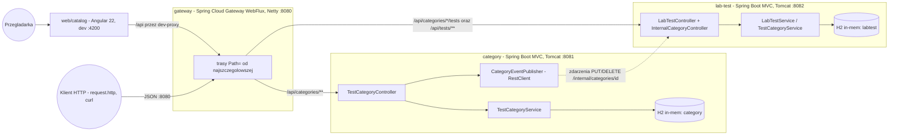
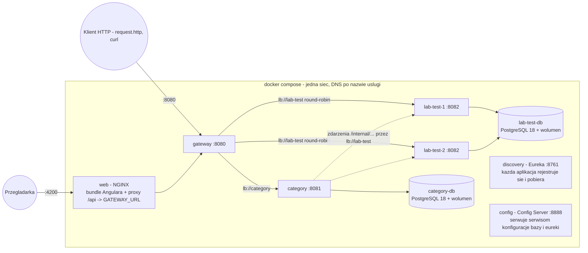
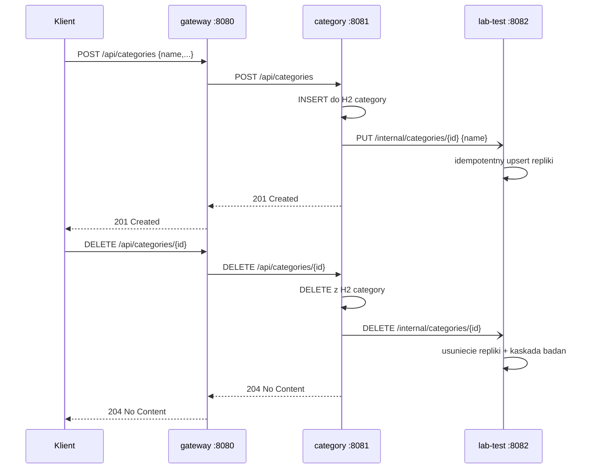
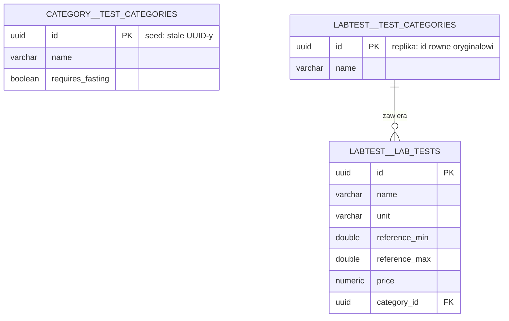

# Medata — architektura

> Wersja polska. Angielski odpowiednik 1:1: [../en/ARCHITECTURE.md](../en/ARCHITECTURE.md)
> Stan na: lab 7 (discovery, load balancing, migracje, centralna konfiguracja). Konwencja §6: zmiana architektury bez aktualizacji diagramu = zmiana nieukończona.

## Widok kontenerów (tryb deweloperski)

Każdy serwis ma **prywatną** bazę — nie istnieje wspólny schemat ani klucz obcy między serwisami. Spójność utrzymują zdarzenia REST i stałe UUID-y seedu. W trybie deweloperskim bazą jest H2 in-memory; pod Docker Compose ten sam jar rozmawia z PostgreSQL, a przełącza to config-serwis plus zmienne środowiskowe (patrz niżej). Od labu 7 tryb deweloperski potrzebuje też discovery na :8761, bo gateway rozwiązuje cele `lb://` z rejestru.

## Widok runtime (Docker Compose — lab 7)

Porty na hoście publikują `web` (:4200), `gateway` (:8080) oraz dwa infrastrukturalne dashboardy, `discovery` (:8761) i `config` (:8888). Serwisy biznesowe i obie bazy pozostają wewnątrz sieci. Adresowanie idzie teraz po nazwach logicznych. Aplikacje rejestrują się w Eurece pod swoim `spring.application.name`, gateway trasuje przez `lb://`, a serwis category publikuje zdarzenia na `http://lab-test`, oba rozwiązywane z lokalnej kopii rejestru z round-robinem po dwóch instancjach lab-test. Konfigurację bazy i eureki dla serwisów serwuje config-serwis (backend `native`), więc środowisko niesie tylko `CONFIG_URL`, `INSTANCE_ID` per instancja, poświadczenia baz, `DISCOVERY_URL` dla gatewaya i `GATEWAY_URL` dla NGINX-a. Named volumes utrzymują obie bazy między restartami, a Flyway migruje każdy schemat dokładnie raz, bo jego blokada w bazie serializuje dwie instancje lab-test.

## Przepływ zdarzeń (synchronizacja repliki)

Wysyłka jest **best-effort**: błąd sieci nie psuje operacji na kategorii (`try/catch` → WARN w logu). Handlery w `lab-test` są **idempotentne** (PUT = upsert, DELETE nieistniejącej → 204), więc powtórzone zdarzenie nie szkodzi. Zmiana nazwy kategorii NIE jest propagowana (świadoma luka — instrukcja wymaga zdarzeń tylko przy dodaniu/usunięciu).

## Routing (gateway)

| Kolejność | Predykat `Path=` | Cel |
|---|---|---|
| 0 | `/api/categories/*/tests` | `lb://lab-test` |
| 1 | `/api/categories/**` | `lb://category` |
| 2 | `/api/tests/**` | `lb://lab-test` |

Kolejność od najszczegółowszej — catch-all kategorii przechwyciłby żądania o badania. `/internal/**` celowo **bez trasy**: API zdarzeń jest nieosiągalne z zewnątrz. Wykonywalne przykłady: `services/gateway/request.http` (wszystko przez :8080).

## API per serwis

- **category (:8081):** `GET/POST /api/categories`, `GET/PUT/DELETE /api/categories/{id}` — semantyka i kody jak w labie 3; POST i DELETE dodatkowo publikują zdarzenie do lab-test.
- **lab-test (:8082):** `GET /api/tests`, `GET/PUT/DELETE /api/tests/{id}`, `GET/POST /api/categories/{categoryId}/tests` oraz wewnętrzne `PUT/DELETE /internal/categories/{id}`. Szczegółowe tabele: `services/<nazwa>/docs/pl/README.md`.

## Model danych (ERD) — dwie prywatne bazy

Prefiks oznacza bazę (`category` / `labtest`). Replika trzyma minimum potrzebne do relacji i DTO; kaskada `REMOVE` + `orphanRemoval` działa lokalnie w bazie labtest.

## Plany

Faza labowa kursu jest ukończona (laby 1 do 7). Dalej czeka faza FUTURE z WIZJI, zaczynając od zleceń i wyników z flagowaniem, rozwijana na gałęziach `feat/*`.
